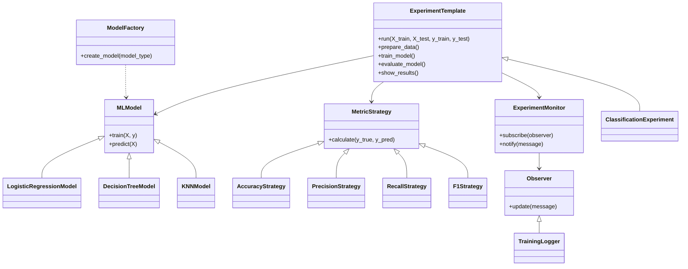

# Mini projekat 2 – ML eksperimentalni okvir

**Predmet:** Napredno programiranje  
**Student:** Ivona Dabović  
**Broj indeksa:** 26/019

## 1. Opis projekta

Cilj projekta je razvoj jednostavnog okvira za izvođenje eksperimenata mašinskog učenja (Machine Learning), uz primjenu objektno-orijentisanog programiranja i projektnih obrazaca (Design Patterns).

Okvir omogućava kreiranje različitih modela, treniranje, evaluaciju pomoću više metrika, praćenje procesa i mjerenje vremena izvršavanja.

Za demonstraciju je korišćen Iris skup podataka iz biblioteke Scikit-learn.

## 2. Korišćeni alati i biblioteke

- Python
- Scikit-learn
- NumPy
- Pandas
- Pytest
- Ruff
- Google Colab

## 3. Iris skup podataka

Iris je skup podataka koji sadrži 150 uzoraka cvijeća irisa, četiri numeričke karakteristike i tri klase:

- Setosa
- Versicolor
- Virginica

Podaci su podijeljeni na trening i test skup u odnosu 80:20. Korišćen je `random_state=42`, kao i stratifikovana podjela, kako bi zastupljenost klasa bila očuvana.

## 4. Primijenjeni projektni obrasci

### Factory Pattern

Koristi se za kreiranje modela na osnovu naziva modela. Klasa `ModelFactory` omogućava kreiranje tri različita klasifikaciona modela:

- Logistic Regression
- Decision Tree
- K-Nearest Neighbors (KNN)

Na ovaj način ostatak programa ne mora direktno da poznaje način kreiranja svakog modela.

### Strategy Pattern

Koristi se za implementaciju različitih metrika evaluacije. Svaka metrika ima sopstvenu klasu:

- Accuracy
- Precision
- Recall
- F1-score

Metrike se mogu koristiti i mijenjati nezavisno jedna od druge.

### Observer Pattern

Omogućava praćenje procesa izvođenja eksperimenta. Klasa `ExperimentMonitor` obavještava registrovane posmatrače o događajima, dok `TrainingLogger` prikazuje poruke o početku i završetku pojedinih faza.

### Template Method Pattern

Klasa `ExperimentTemplate` definiše osnovni redosljed koraka eksperimenta:

1. Priprema podataka
2. Treniranje modela
3. Evaluacija modela
4. Prikaz rezultata

Klasa `ClassificationExperiment` implementira pripremu podataka za klasifikacioni eksperiment.

### Decorator Pattern

Dekorator `measure_time` mjeri vrijeme izvršavanja funkcije `run_experiment`, bez potrebe da se mijenja njena osnovna logika.

## 5. Rezultati eksperimenata

Na Iris skupu podataka testirana su tri klasifikaciona modela.

| Model | Accuracy | Precision | Recall | F1-score |
|---|---:|---:|---:|---:|
| Logistic Regression | 0.9667 | 0.9697 | 0.9667 | 0.9666 |
| Decision Tree | 0.9333 | 0.9333 | 0.9333 | 0.9333 |
| KNN | 1.0000 | 1.0000 | 1.0000 | 1.0000 |

U ovom eksperimentu KNN model ostvario je najbolje rezultate na test skupu. Rezultati se odnose na konkretnu podjelu podataka i ne predstavljaju garanciju istih performansi na drugim skupovima podataka.

## 6. Testiranje

Za testiranje je korišćen Pytest.

Implementirano je sedam testova koji provjeravaju:

1. Kreiranje Logistic Regression modela.
2. Kreiranje Decision Tree modela.
3. Kreiranje KNN modela.
4. Reakciju Factory obrasca na nepoznat model.
5. Izračunavanje metrika.
6. Funkcionisanje Observer obrasca.
7. Izvođenje eksperimenta i vraćanje rezultata.

Rezultat testiranja:

`7 passed`

Dodatno je izvršena provjera kvaliteta koda pomoću Ruff alata:

`All checks passed!`

## 7. Pokretanje projekta

Instalacija potrebnih biblioteka:

```bash
pip install scikit-learn pytest ruff
```

Pokretanje programa:

```bash
python mini_projekat_2.py
```

Pokretanje testova:

```bash
pytest -q
```

Provjera kvaliteta koda:

```bash
ruff check mini_projekat_2.py test_mini_projekat_2.py
```

## 8. Dijagram klasa



## 9. Upotreba AI alata

AI alat je korišćen kao pomoć pri razumijevanju projektnih obrazaca, organizaciji strukture programa, pisanju i ispravljanju koda, kao i pri pripremi testova i dokumentacije.

Dobijena rješenja su provjerena kroz izvršavanje programa, Pytest testove i Ruff provjeru kvaliteta koda.
